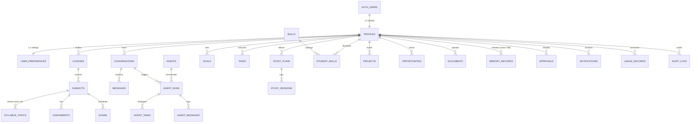

# STUDENT OS — Database Design & Schema Specification

**Database Engine:** Supabase PostgreSQL 15+ with `pgcrypto` and `pgvector`  
**Security Model:** Row Level Security (RLS) enforced on 100% of tables using `auth.uid()`

---

## 1. Entity Relationship Diagram

---

## 2. Implemented Core Tables (`supabase/migrations/0001_initial_schema.sql`)

| Domain | Table Name | Primary Key | Ownership / Tenant Column | Purpose |
|---|---|---|---|---|
| Identity | `public.profiles` | `id` (`uuid`, FK `auth.users`) | `id = auth.uid()` | Student academic & career identity, persona, onboarding state |
| Identity | `public.user_preferences` | `user_id` (`uuid`, FK `profiles`) | `user_id = auth.uid()` | Theme, language, voice toggle, daily study hour targets |
| AI System | `public.agents` | `id` (`uuid`) | Read-only public catalog | All 16 agent definitions, prompts, schemas, and tool allowlists |
| AI System | `public.conversations` | `id` (`uuid`) | `user_id` | Persistent chat threads with the AI CEO |
| AI System | `public.messages` | `id` (`uuid`) | `user_id` | User and assistant messages with structured metadata |
| AI System | `public.agent_runs` | `id` (`uuid`) | `user_id` | Top-level CEO execution lifecycle state & plan |
| AI System | `public.agent_tasks` | `id` (`uuid`) | Via `run_id -> agent_runs.user_id` | Individual specialist agent task inputs, outputs, and status |
| AI System | `public.agent_messages` | `id` (`uuid`) | Via `run_id -> agent_runs.user_id` | Inter-agent communication trace |
| Academic | `public.courses` | `id` (`uuid`) | `user_id` | Degree / semester course groupings |
| Academic | `public.subjects` | `id` (`uuid`) | Via `course_id -> courses.user_id` | Individual semester subjects, codes, and credits |
| Academic | `public.syllabus_topics` | `id` (`uuid`) | Via `subject_id -> courses.user_id` | Unit-by-unit syllabus topics and mastery status |
| Academic | `public.assignments` | `id` (`uuid`) | `user_id` | Coursework deadlines and submission statuses |
| Academic | `public.exams` | `id` (`uuid`) | `user_id` | Scheduled quizzes, midterms, and final exams |
| Productivity | `public.goals` | `id` (`uuid`) | `user_id` | High-level academic, career, skill, and wellbeing goals |
| Productivity | `public.tasks` | `id` (`uuid`) | `user_id` | Actionable tasks with priority, due date, and `source_agent_id` |
| Learning | `public.study_plans` | `id` (`uuid`) | `user_id` | Structured JSON study schedules generated by Study Agent |
| Learning | `public.study_sessions` | `id` (`uuid`) | `user_id` | Logged focus sessions linked to subjects and study plans |
| Career | `public.skills` | `id` (`uuid`) | Read-only catalog | Normalised skill taxonomy |
| Career | `public.student_skills` | `id` (`uuid`) | `user_id` | Student skill proficiency (`beginner` to `expert`) |
| Career | `public.projects` | `id` (`uuid`) | `user_id` | Portfolio projects, tech stacks, statuses, and repo links |
| Career | `public.opportunities` | `id` (`uuid`) | `user_id` | Saved internships, hackathons, scholarships + source verification |
| Knowledge | `public.documents` | `id` (`uuid`) | `user_id` | Uploaded syllabus/research files in Supabase Storage |
| Knowledge | `public.memory_records` | `id` (`uuid`) | `user_id` | Long-term student memory with `vector(768)` embeddings |
| Operations | `public.approvals` | `id` (`uuid`) | `user_id` | Human-in-the-loop approval requests and decisions |
| Operations | `public.notifications` | `id` (`uuid`) | `user_id` | Deadline warnings, approval alerts, and briefing notifications |
| Operations | `public.usage_records` | `id` (`uuid`) | `user_id` | Per-call token usage and estimated cost ledger |
| Operations | `public.audit_logs` | `id` (`uuid`) | `user_id` | Security and consequential action audit trail |

---

## 3. Phase 2 Schema Expansion Tables (Planned Migration `0003_department_extensions.sql`)

To fully support Modules 6, 8, 9, 11, and background workers without schema drift, the following tables are scheduled for Phase 2:

1. `public.career_roadmaps` (`id`, `user_id`, `target_role`, `milestones jsonb`, `status`, `created_at`)
2. `public.applications` (`id`, `user_id`, `opportunity_id`, `stage`, `notes`, `applied_at`) — *tracks student-confirmed application stages separately from saved opportunities.*
3. `public.learning_resources` (`id`, `user_id`, `subject_id`, `title`, `url`, `resource_type`, `notes`)
4. `public.expenses` (`id`, `user_id`, `category`, `amount numeric`, `currency text default 'INR'`, `spent_at`, `note`) — *powers Finance Agent (#15).*
5. `public.habits` & `public.wellbeing_checkins` — *powers Wellbeing Agent (#16).*
6. `public.scheduled_jobs` (`id`, `user_id`, `job_type`, `payload jsonb`, `status`, `run_at`, `attempts`) — *database-backed background queue.*

---

## 4. Indexing & Row Level Security (RLS) Rules

- **Composite Indexes Implemented:**
  - `idx_tasks_user_status` on `tasks(user_id, status)`
  - `idx_tasks_due` on `tasks(user_id, due_at)`
  - `idx_messages_conversation` on `messages(conversation_id, created_at)`
  - `idx_agent_runs_user` on `agent_runs(user_id, created_at desc)`
  - `idx_agent_tasks_run` on `agent_tasks(run_id, status)`
  - `idx_memory_user` on `memory_records(user_id, category)`
  - `idx_notifications_user` on `notifications(user_id, created_at desc)`
  - `idx_approvals_user_status` on `approvals(user_id, status)`
- **RLS Isolation Guarantee:**
  - Direct tables enforce `using (auth.uid() = user_id) with check (auth.uid() = user_id)`.
  - Child tables (`subjects`, `syllabus_topics`, `agent_tasks`, `agent_messages`) enforce ownership via `EXISTS` joins against their parent user-owned table.
  - `public.agents` and `public.skills` allow `SELECT` for authenticated users and restrict `INSERT/UPDATE/DELETE` to the server-side service role.

