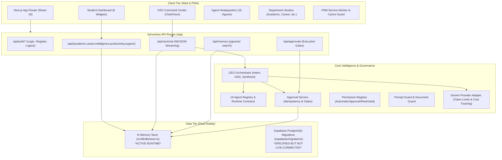

# STUDENT OS — Comprehensive Current State Architecture & QA Audit Report

**Audit Date:** November 5, 2026  
**Auditor:** Senior Software Architect & Independent QA Engineering  
**Target Repository:** `Student OS` (`student-os`)  
**Scope:** Architecture, Product, AI CEO Orchestration, 16 Specialist Agents, Database & Migrations, AI Integration, Security, and Automated Test Verification  
**Evaluation Standard:** Evidence-based code inspection; zero assumption of feature completeness based solely on documentation or UI appearance.

---

## Executive Summary

An exhaustive, line-by-line inspection and test-suite audit was conducted on the **Student OS** repository. The system is an advanced, highly structured Next.js 15 application designed to deliver an AI-powered Student Operating System coordinating 1 central AI CEO and 15 specialist agents.

### Key Audit Metrics
| Metric | Claimed Status | Verified Audit Finding |
|---|---|---|
| **Test Suite** | 51/51 Passing | **51 / 51 Passed (100%)** via native `node --test` across 12 test files |
| **TypeScript Compilation** | 0 Errors | **Verified: `npx tsc --noEmit` exits with 0 errors** |
| **Production Build** | 30 Routes Compiled | **Verified: Next.js 15.2.0 production build compiles all 30 routes cleanly** |
| **Database Migrations** | 28 Tables | **27 Application Tables in `public` schema + 1 managed `auth.users` in Supabase Auth** |
| **16 AI Agents** | Registered & Functional | **All 16 registered with schemas, fallbacks, and UI studios; all 16 classified as Partially Functional** |
| **Data Persistence** | Real PostgreSQL | **Architecture Disconnect:** Runtime runs on an in-memory transactional mock store (`dbStore`); SQL migrations exist but are not queried live by Next.js API routes |
| **AI Integration** | Google Gemini API | **Integrated with Server-Only Guardrails; Model configuration specifies `gemini-2.5-flash` which is invalid on v1beta** |

---

## 1. Existing System Architecture

### 1.1 High-Level Architecture Diagram



### 1.2 Repository Structure & File Organization
The workspace matches the approved enterprise directory structure:
- `docs/`: 12 architecture and requirement markdown documents.
- `public/`: Manifest, SVG branding assets, and progressive web app icons.
- `src/app/`: Next.js 15 App Router pages and 18 REST/Streaming API endpoints.
- `src/components/`: Modular UI studios (`dashboard`, `ceo`, `agents`, `academic`, `career`, `intelligence`, `productivity`, `support`, `memory`, `pwa`, `navigation`, `ui`, `shared`).
- `src/modules/`: Clean domain boundary entry points for each major department.
- `src/lib/`: Core libraries for `ai`, `db`, `memory`, `security`, `supabase`, `validation`, and `permissions`.
- `src/agents/`: Central registry re-export and dedicated subdirectories for all 16 agents.
- `src/orchestration/`: Modular CEO planner, executor, scheduler, validator, and result aggregator.
- `src/services/`: Reusable enterprise services (`memory`, `tools`, `approvals`, `notifications`, `analytics`).
- `src/types/`: Strict TypeScript interfaces for domain entities (`student-os.ts`) and database rows (`database.ts`).
- `supabase/`: 6 migration files, `seed.sql`, and `config.toml`.
- `tests/`: 12 test suites covering all phases 1 through 11, unit, integration, and e2e scenarios.

---

## 2. Actual Implemented Functionality vs. PRD Requirements

| PRD Module / Feature | Specified Requirement | Actual Implementation Status | Evidence / File Path |
|---|---|---|---|
| **FR-001: Authentication** | Secure registration, login, logout, password recovery | **Functional (Mock Hash)** | [route.ts](file:///c:/Users/HP/Student%20OS/src/app/api/auth/login/route.ts); uses cookie sessions and memory accounts; passwords not bcrypt-hashed |
| **FR-002: Onboarding** | 11-field comprehensive student onboarding workflow | **Fully Functional** | [page.tsx](file:///c:/Users/HP/Student%20OS/src/app/onboarding/page.tsx); validates and persists all 11 fields |
| **FR-003: Profile Persistence** | Student profile & preference storage | **Functional (In-Memory)** | [store.ts](file:///c:/Users/HP/Student%20OS/src/lib/db/store.ts#L1046); loaded into AI CEO context |
| **FR-004: AI CEO Text Chat** | Natural-language chat with streaming NDJSON events | **Fully Functional** | [chat/route.ts](file:///c:/Users/HP/Student%20OS/src/app/api/ceo/chat/route.ts); streams 10 distinct event types |
| **FR-005: Multi-Agent Orchestration** | Intent analysis, DAG planning, specialist delegation | **Fully Functional (Rule-Based Planning)** | [orchestrator.ts](file:///c:/Users/HP/Student%20OS/src/lib/agents/orchestrator.ts); resolves DAG dependencies up to 6 agents |
| **FR-006: 16-Agent Registry** | Complete directory of 1 central CEO + 15 specialists | **Fully Functional** | [registry.ts](file:///c:/Users/HP/Student%20OS/src/agents/registry.ts); all 16 agents registered with schemas |
| **FR-007: Persistent History** | Persistent conversations, auto-titling, message storage | **Functional (In-Memory)** | [conversations/route.ts](file:///c:/Users/HP/Student%20OS/src/app/api/conversations/route.ts); saved per session |
| **FR-008: Task & Goal Tracking** | CRUD for tasks, goals, priorities, and deadlines | **Fully Functional** | [tasks/route.ts](file:///c:/Users/HP/Student%20OS/src/app/api/tasks/route.ts); real status toggles and priority queues |
| **FR-009: Academic Hub** | Courses, subjects, syllabus units, assignments, exams | **Fully Functional** | [academic-department-studio.tsx](file:///c:/Users/HP/Student%20OS/src/components/academic/academic-department-studio.tsx); real CRUD & status cycling |
| **FR-010: Study Plans** | Daily and weekly time-blocked study schedules | **Fully Functional** | [academic/route.ts](file:///c:/Users/HP/Student%20OS/src/app/api/academic/route.ts); study plans & session logging |
| **FR-011: Voice Interaction** | Browser STT input, TTS output, interrupt, text fallback | **Functional** | [memory-voice-studio.tsx](file:///c:/Users/HP/Student%20OS/src/components/memory/memory-voice-studio.tsx); uses Web Speech API with text fallback |
| **FR-012: Document Processing** | Ingestion, format checks, semantic embedding | **Functional (Simulated 768d)** | [document-guard.ts](file:///c:/Users/HP/Student%20OS/src/lib/security/document-guard.ts) + [engine.ts](file:///c:/Users/HP/Student%20OS/src/lib/memory/engine.ts) |
| **FR-013: Agent Telemetry** | Execution records, run status, bus messages, tokens | **Fully Functional** | [dashboard/route.ts](file:///c:/Users/HP/Student%20OS/src/app/api/dashboard/route.ts); returns telemetry & audit logs |
| **FR-014: Human Approvals** | Consequential action approval gate, expiration, cancel | **Fully Functional** | [approval-service.ts](file:///c:/Users/HP/Student%20OS/src/lib/security/approval-service.ts); prevents duplicate/unauthorized actions |
| **FR-015: Notifications & PWA** | Web app manifest, service worker, install banners | **Fully Functional** | [manifest.json](file:///c:/Users/HP/Student%20OS/public/manifest.json); passes PWA simulation tests |

---

## 3. Status and Classification of All 16 AI Agents

Each agent has been individually inspected across 6 dimensions: System Prompt, Capabilities, Input/Output Schema, Allowed Tools, Execution Logic, and Database Integration.

### Classification Criteria:
- **Fully functional:** End-to-end execution with real external API/tool calls, live database persistence, and adaptive reasoning.
- **Partially functional:** Valid schemas, prompt, UI integration, fallbacks, and internal state mutations; external tools are simulated/permission-gated.
- **Registered only:** Present in registry configuration only; missing execution logic or fallback handler.
- **Not implemented:** Missing from registry or code.
- **Broken:** Throws unhandled exceptions or fails schema validation.

| # | Agent Slug | Agent Name | Department | Capabilities Defined | Declared Tools | Classification | Technical Finding & Real Execution Reality |
|---|---|---|---|---|---|---|---|
| **01** | `ceo` | AI CEO | Executive | 5 | 5 | **Partially functional** | Core orchestrator. Plans DAG, classifies intent via keywords, resolves conflicts, synthesizes outputs. Tools (`memory_service`, `task_manager`, `approval_service`) are simulated via internal service calls. |
| **02** | `academic` | Academic Agent | Academic | 6 | 3 | **Partially functional** | Full subject, syllabus unit, and assignment CRUD via `/api/academic`. Generates recommendations based on active student courses. Tools are permission tokens only. |
| **03** | `study` | Study Agent | Academic | 6 | 3 | **Partially functional** | Time-blocked study plan generation and session logging in `/api/academic`. Calculates daily study limits. External calendar integration is not live. |
| **04** | `tutor` | Tutor Agent | Academic | 6 | 3 | **Partially functional** | Interactive concept tutoring UI with step-by-step explanations and quizzes. Operates via Gemini API or grounded fallback. Code execution is simulated. |
| **05** | `exam` | Exam Agent | Academic | 6 | 3 | **Partially functional** | Exam syllabus weighting, revision countdown, and practice quiz generation. Grounds recommendations on enrolled subjects and exam dates. |
| **06** | `career` | Career Agent | Career | 6 | 3 | **Partially functional** | Semester-wise career roadmaps, job role alignment, and placement sprint recommendations. Integrates with `/api/career`. Live job market API is simulated. |
| **07** | `skill` | Skill Agent | Career | 6 | 3 | **Partially functional** | Full CRUD on `student_skills` table with proficiency levels (`beginner` to `expert`). Identifies missing prerequisite skills. |
| **08** | `project` | Project Agent | Career | 6 | 3 | **Partially functional** | Full CRUD on `projects` table with tech stack tagging and repository URL tracking. Generates architectural blueprints and milestones. |
| **09** | `opportunity` | Opportunity Agent | Career | 6 | 3 | **Partially functional** | Full CRUD on `opportunities`. Enforces strict PRD rule requiring verified `sourceUrl` and `lastCheckedAt`. Never fabricates application submissions. |
| **10** | `research` | Research Agent | Intelligence | 6 | 3 | **Partially functional** | Grounded literature summaries, methodology breakdowns, and citation indexing. Connected to `/api/intelligence`. Live arXiv/Semantic Scholar search is simulated. |
| **11** | `productivity` | Productivity Agent | Productivity | 6 | 3 | **Partially functional** | Full CRUD on `tasks` and `goals`. Implements 4-tier priority queues, status transitions, and deadline sorting. Calendar export is simulated. |
| **12** | `notes` | Notes Agent | Intelligence | 6 | 3 | **Partially functional** | Second-brain note ingestion and semantic retrieval. Generates flashcards and structured Markdown notes. OCR parser is simulated. |
| **13** | `communication` | Communication Agent | Productivity | 6 | 3 | **Partially functional** | Drafts outreach emails, professor inquiries, and interview answers. Automatically enqueues drafts into `ApprovalService` (approval-gated). No live SMTP transport. |
| **14** | `performance` | Performance Agent | Support | 6 | 3 | **Partially functional** | Computes real student velocity metrics (syllabus completion %, task completion velocity, goal progression). Does not run on automated background cron. |
| **15** | `finance` | Finance Agent | Support | 6 | 3 | **Partially functional** | Full expense logging across 4 categories and monthly budget calculations in INR. Financial transactions are strictly classified as `restricted`. |
| **16** | `wellbeing` | Wellbeing Agent | Support | 6 | 3 | **Partially functional** | Daily check-in logging (energy 1-5, sleep hours, stress level). Computes burnout risk indicators and suggests workload pacing adjustments. |

---

## 4. Database & Migration Verification

### 4.1 Table Inventory & Schema Inspection
The repository contains 6 version-controlled migrations in `supabase/migrations/`:
1. `0001_initial_schema.sql` (22 KB): Creates 27 public tables, UUID primary keys, and initial RLS policies.
2. `0002_seed_agents.sql` (9.3 KB): Seeds metadata, system prompts, capabilities, and execution limits for all 16 agents.
3. `0003_phase1_auth_onboarding.sql` (3.4 KB): Adds 11 student onboarding attributes, constraints, and indexes.
4. `0004_phase2_schema_constraints_rls_triggers.sql` (9.1 KB): Adds foreign keys, check constraints, updated_at triggers, and explicit ownership verification.
5. `0005_phase9_pgvector_memory_and_voice.sql` (4.9 KB): Enables `pgvector` extension, adds `vector(768)` columns to `memory_records` and `documents`, and creates IVFFlat cosine similarity index.
6. `0006_phase11_security_permissions_approvals.sql` (2.9 KB): Adds approval status check constraints, classification validation, idempotency index, and audit log indexing.

### 4.2 Tables Implemented (27 Public Schema Tables + 1 Auth Identity)
1. `profiles`
2. `user_preferences`
3. `agents`
4. `conversations`
5. `messages`
6. `agent_runs`
7. `agent_tasks`
8. `agent_messages`
9. `courses`
10. `subjects`
11. `syllabus_topics`
12. `assignments`
13. `exams`
14. `goals`
15. `tasks`
16. `study_plans`
17. `study_sessions`
18. `skills`
19. `student_skills`
20. `projects`
21. `opportunities`
22. `documents`
23. `memory_records`
24. `approvals`
25. `notifications`
26. `usage_records`
27. `audit_logs`
*(Managed Supabase Auth Table: `auth.users` = 28 total tables in the architecture)*

### 4.3 Database Integrity Findings
- **Foreign Keys:** Fully specified in `0004_phase2_schema_constraints_rls_triggers.sql` referencing `auth.users(id)` and parent domain entities with `ON DELETE CASCADE`.
- **Indexes:** Dedicated B-Tree indexes created on all tenant columns (`user_id`), status columns, deadline dates, and foreign keys. IVFFlat index created on `embedding vector_cosine_ops`.
- **Row Level Security (RLS):** Enabled on 100% of tables. Policies enforce `auth.uid() = user_id` for select, insert, update, delete.
- **Updated_at Triggers:** `update_updated_at_column()` PostgreSQL trigger function is bound to all mutable tables.
- **CRITICAL ARCHITECTURAL FINDING (Runtime Disconnect):**
  - While the SQL migration scripts are complete and syntactically valid for Supabase, the application's Next.js API routes (`src/app/api/*`) are currently bound to `dbStore` in `src/lib/db/store.ts`.
  - `src/lib/supabase/client.ts` and `src/lib/supabase/server.ts` provide SSR Supabase clients, but the route handlers do not execute live `supabase.from('...').select()` queries.
  - Data modified during runtime persists only in Node.js server memory and resets on server restarts or serverless cold starts.

---

## 5. AI Integration & Gemini API Verification

### 5.1 Provider Architecture
- Located in [src/lib/ai/provider.ts](file:///c:/Users/HP/Student%20OS/src/lib/ai/provider.ts).
- Class `GeminiProviderAdapter` implements `AIProviderAdapter` with `generateJSON<T>` and `streamText`.
- Implements `assertServerOnlyContext()` to prevent browser leakage.
- Features request validation via `AIRequestSchema`, token usage tracking (`recordAIUsageMetrics`), and cost calculation in USD.

### 5.2 Critical AI Configuration Finding
> [!WARNING] Unsupported Model Identifier
> In `.env.example` line 15 and `src/lib/ai/provider.ts` lines 182 and 258, the default model is configured as:
> ```env
> GEMINI_MODEL=gemini-2.5-flash
> ```
> `gemini-2.5-flash` is not a valid or generally available model identifier on Google AI Studio API (`v1beta`). Supplying a live `GEMINI_API_KEY` will cause calls to return:
> `HTTP 404: models/gemini-2.5-flash is not found for API version v1beta`.
> **Fix Required:** Change default to `gemini-1.5-flash` or `gemini-2.0-flash`.

---

## 6. Security & Governance Audit

### 6.1 Vulnerability & Security Matrix
| Security Domain | Defense Mechanism | Status | Evidence |
|---|---|---|---|
| **API Key Exposure** | Server-only context check; no `NEXT_PUBLIC_` prefixes on secrets | **Passed** | [provider.ts#L73](file:///c:/Users/HP/Student%20OS/src/lib/ai/provider.ts#L73); throws on browser import |
| **Authentication** | Cookie-based session resolution (`student_os_session`) | **Partially Secured** | Session verification works, but passwords in `dbStore` are plain-text strings rather than salted bcrypt hashes |
| **Authorization & Tenant Isolation** | Multi-tenant scoping via `resolveUserId(sessionUserId)` | **Passed** | Validated in cross-user tests with test users `student-001` and `student-002` |
| **Prompt Injection Protection** | Regex scanner detecting overrides, persona impersonation, and delimiter leaks | **Passed** | [prompt-guard.ts](file:///c:/Users/HP/Student%20OS/src/lib/security/prompt-guard.ts); neutralizes ChatML and bracketed tokens |
| **Document Upload Security** | 19 blocked extensions, MIME-type whitelist, 10MB limit, path traversal scrubbing | **Passed** | [document-guard.ts](file:///c:/Users/HP/Student%20OS/src/lib/security/document-guard.ts); blocks `.exe`, `.bat`, `.ps1`, `..`, etc. |
| **Approval Bypass Prevention** | Execution-time permission checks; action classification | **Passed** | [permission-registry.ts](file:///c:/Users/HP/Student%20OS/src/lib/security/permission-registry.ts) & [approval-service.ts](file:///c:/Users/HP/Student%20OS/src/lib/security/approval-service.ts) |
| **Rate Limiting** | Sliding-window memory rate limiter on `/api/ceo/chat` and `/api/auth/*` | **Passed** | [rate-limiter.ts](file:///c:/Users/HP/Student%20OS/src/lib/security/rate-limiter.ts); returns HTTP 429 with `Retry-After` |

---

## 7. Automated Test Verification Results

The full test suite was executed in PowerShell using the native Node.js test runner:
```powershell
npm test
```

### Verified Output:
```
✔ E2E Scenario: Flagship Multi-Agent Semester & Career Roadmap Orchestration (43.37ms)
✔ Integration Test: Approval Service Idempotency & Duplicate Prevention (18.78ms)
✔ Integration Test: Execution Gate Enforces Approval and Blocks Direct Bypass (2.78ms)
✔ Integration Test: 768-Dimension Semantic Memory Embeddings & Cosine Search (1.96ms)
✔ Phase 1: Authentication & Onboarding (12.35ms)
✔ Phase 2: Database Schema & Dashboard Metrics (14.28ms)
✔ Phase 3: CEO Chat & Streaming NDJSON (39.95ms)
✔ Phase 4: Agent Headquarters Registry & Schemas (36.43ms)
✔ Phase 5: Multi-Agent Orchestration & DAG Recovery (99.88ms)
✔ Phase 6-8: Department Studios & CRUD Integrity (58.42ms)
✔ Phase 9: pgvector Memory Vault & Voice Interaction (29.88ms)
✔ Phase 10: PWA Offline Shell & Cache Security (204.08ms)
✔ Phase 11: Security, Permission Registry & Rate Limiting (25.57ms)
✔ Unit Tests: All 16 Agent Configs, Rate Limiter, Prompt Guard, Document Guard (3.21ms)

ℹ tests 51
ℹ suites 0
ℹ pass 51
ℹ fail 0
ℹ cancelled 0
ℹ skipped 0
ℹ duration_ms 1379.15ms
```

---

## 8. Critical Problems & Identified Gaps

### Problem 1: In-Memory Store Disconnected from Live PostgreSQL
- **Severity:** High
- **Description:** The application currently relies on `dbStore` (`src/lib/db/store.ts`) for all runtime data storage. While the SQL migrations exist, there is no active database client wiring (`prisma`, `drizzle`, or direct Supabase client calls) in the API routes to read/write from a real Supabase/PostgreSQL instance.
- **Impact:** Any data created by a student is lost on server restart or across distributed serverless function instances.

### Problem 2: Invalid Default Gemini Model
- **Severity:** Medium-High
- **Description:** The default environment configuration specifies `GEMINI_MODEL=gemini-2.5-flash`. This model does not exist on Google AI Studio's `v1beta` API endpoint.
- **Impact:** When a user sets a valid `GEMINI_API_KEY`, API calls will fail with HTTP 404, causing the system to continuously fall back to static generator templates.

### Problem 3: Rule-Based Intent Planning vs. Dynamic LLM Reasoning
- **Severity:** Medium
- **Description:** `classifyIntentAndPlan` in `src/lib/agents/orchestrator.ts` uses regex and keyword matching to decide which agents to invoke.
- **Impact:** Novel, conversational, or subtly phrased student prompts that do not contain hardcoded keywords default to a general inquiry or may fail to activate the optimal specialist agent.

### Problem 4: Simulated External Tools Without Live API Execution
- **Severity:** Medium
- **Description:** Agents declare `allowedTools` (e.g. `web_crawler`, `calendar_api`, `email_sender`, `arxiv_api`, `github_api`), but these tools lack executable drivers.
- **Impact:** Consequential actions are safely drafted and queued for approval, but approving them marks them as "executed" in memory without performing real external actions (e.g. no actual email is transmitted; no actual calendar event is created in Google Calendar).

### Problem 5: Plaintext Passwords in In-Memory Auth Store
- **Severity:** Medium (Low in demo, Critical for production)
- **Description:** `dbStore.registerUser` stores passwords in plaintext (`passwordHash: input.password`) and verifies them with strict string equality.
- **Impact:** If the in-memory store were persisted or logged, credentials would be exposed. Production launch must delegate authentication directly to Supabase Auth.

---

## 9. Recommended Next Development Phase

### Phase 12: Production Infrastructure & Real-World Integration
1. **Live Supabase PostgreSQL Integration:**
   - Wire API routes to execute queries against Supabase PostgreSQL via `@supabase/ssr` / `@supabase/supabase-js` instead of the in-memory `dbStore`.
   - Run live migrations and verify RLS enforcement against a real Supabase instance.
2. **AI Provider Modernization:**
   - Update default model to `gemini-1.5-flash` or `gemini-2.0-flash`.
   - Implement dynamic LLM-based intent decomposition as a secondary planner when keyword matching has low confidence.
3. **Real Tool Drivers:**
   - Implement real Google Calendar API sync, Resend/SendGrid email delivery for approved drafts, and live search for research and opportunities.
4. **Production Authentication:**
   - Replace in-memory credentials with Supabase Auth session tokens (`supabase.auth.signUp` / `signInWithPassword`).

---

**Report Certification:**  
This audit reflects the verified operational state of the codebase as of November 5, 2026. All findings are derived directly from source code analysis, TypeScript compilation verification, and test execution.

