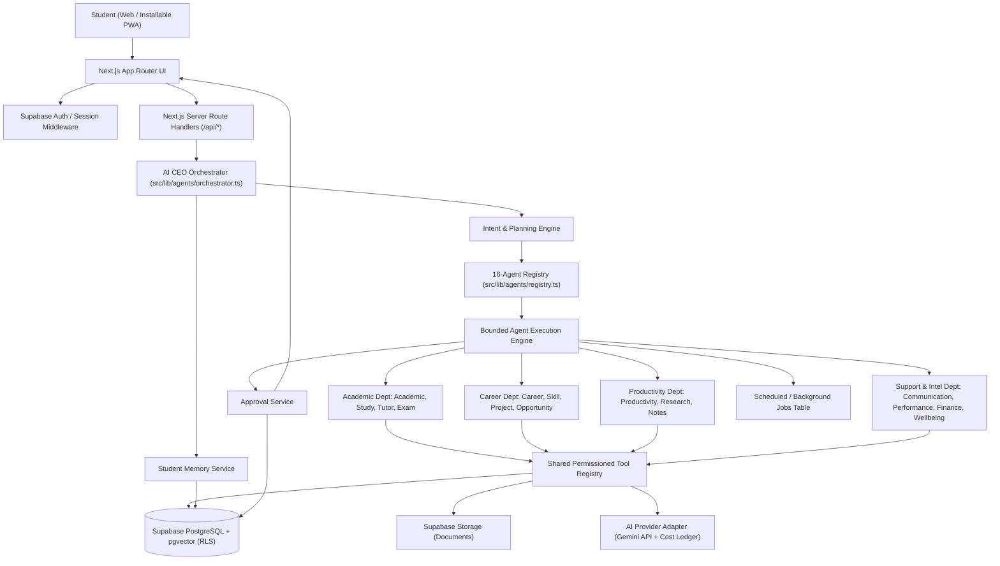
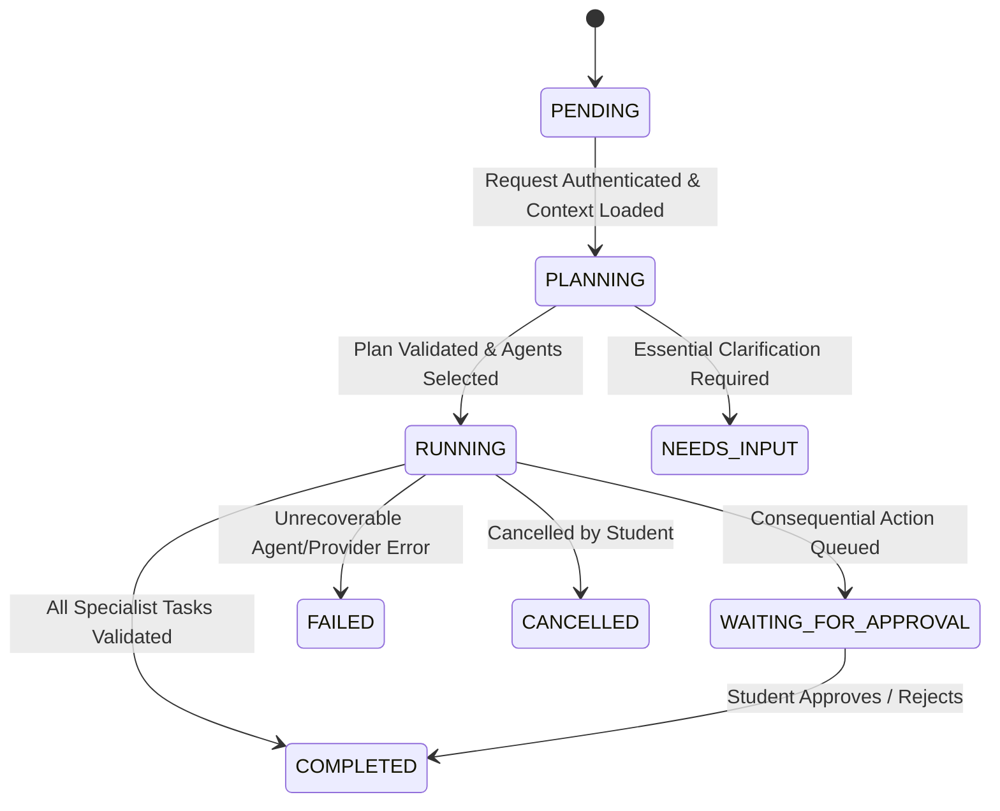

# STUDENT OS — System Architecture Specification

**Version:** 1.0  
**Architectural Pattern:** Modular Monolith (Next.js App Router + TypeScript Orchestration Engine + Supabase + Provider-Independent AI Adapter)

---

## 1. Core Architecture Principles

1. **One Central CEO Orchestrator:** Students converse with a single executive interface (`ceo`); the CEO classifies intent, builds a plan, and delegates to specialists.
2. **Fifteen Specialist Agent Definitions:** Each specialist owns a bounded domain, system prompt, input/output schema, and explicit tool allowlist.
3. **Modular Monolith First:** Frontend, API route handlers, orchestration engine, and agent definitions reside in one repository (`src/`). Do not split into 16 microservices.
4. **Shared Memory Infrastructure:** Structured relational context + `pgvector` semantic memory scoped strictly to the authenticated student.
5. **Central Permission & Tool Registry:** Agents cannot grant themselves permissions, execute raw SQL, or access another student's rows.
6. **Human-in-the-Loop Approval Gate:** Any consequential external action (e.g., external email dispatch, external calendar mutation) transitions the run to `WAITING_FOR_APPROVAL`.
7. **Observable Execution:** Every run (`agent_runs`), delegated step (`agent_tasks`), and inter-agent payload (`agent_messages`) is persisted and streamed to the UI.
8. **Model-Provider Independence:** All LLM calls pass through `src/lib/ai/provider.ts` so Gemini models can be swapped, tiered, or backed by deterministic local fallbacks during offline/local development.

---

## 2. High-Level Architecture Diagram

---

## 3. 15-Step CEO Orchestration Lifecycle

Every natural-language request sent to `POST /api/ceo/chat` executes the following deterministic pipeline:

1. **Receive Request:** Validate request payload with Zod (`message`, `conversationId`, `stream`).
2. **Authenticate Student:** Verify session via Supabase Server Client (`auth.getUser()`) or active local development profile.
3. **Load Student Profile:** Fetch `profiles` and `user_preferences` (degree, semester, daily study hours, career goal, persona).
4. **Retrieve Relevant Memory:** Query recent `memory_records` (academic preferences, active constraints, semantic matches).
5. **Classify Request Intent:** Determine primary domain(s) and required action types.
6. **Select Specialist Agents:** Pick 1 to `MAX_AGENT_DELEGATION_DEPTH` (default `4`) specialist agents from the 16-agent registry.
7. **Generate Execution Plan:** Emit `{ type: "plan_created", plan }` streaming event to the client.
8. **Verify Tool Permissions:** Confirm each selected agent's `allowedTools` covers its planned sub-objective.
9. **Create Execution Record:** Insert row into `agent_runs` with state `PLANNING` -> `RUNNING`.
10. **Delegate Tasks to Agents:** Execute each specialist agent (`agent.execute(input)`), recording `agent_tasks` and `agent_messages` and emitting `agent_started` / `agent_completed` events.
11. **Validate Agent Outputs:** Parse every agent response against `AgentResultSchema` (Zod). Reject or fallback on malformed JSON.
12. **Resolve Conflicts & Missing Info:** Deduplicate overlapping task proposals; transition to `NEEDS_INPUT` if critical parameters are missing.
13. **Persist Approved Outputs & Gate Consequential Actions:**
    - Safe internal actions (e.g., creating a pending study task) are persisted to `tasks` with `source_agent_id`.
    - Consequential actions (`requiresApproval === true`) create a `pending` record in `approvals` and emit `approval_required`.
14. **Synthesise Consolidated CEO Response:** Combine domain findings, recommendations, created tasks, and approval notices into a cohesive executive briefing.
15. **Complete Run & Emit Telemetry:** Update `agent_runs.status` (`COMPLETED` or `WAITING_FOR_APPROVAL`), log token consumption in `usage_records`, and emit `message_complete`.

---

## 4. Execution State Machine

---

## 5. Architectural Conflicts, Missing Requirements & Technical Risks Identified

### A. Architectural Conflicts Resolved
1. **React 19 / Next.js 15 Route Params Async Contract:** In Next.js 15, dynamic route `context.params` is a `Promise<{ id: string }>`. All dynamic routes (such as `/api/approvals/[id]/decision`) must `await context.params` to prevent runtime type/execution errors.
2. **Vector Embedding Dimension Mismatch Risk:** The SQL schema specifies `vector(768)` on `memory_records.embedding`. Google's `text-embedding-004` outputs 768 dimensions by default, whereas `gemini-embedding-001` can output up to 3072 dimensions unless `outputDimensionality: 768` is explicitly passed. **Resolution:** Always pass `outputDimensionality: 768` in the embedding adapter so it matches `vector(768)`.
3. **Serverless Timeout vs. Multi-Agent Chains:** Running 6–10 sequential LLM calls inside a single Vercel Hobby function (10s–60s limit) will time out. **Resolution:** Cap synchronous delegation per turn at `MAX_AGENT_DELEGATION_DEPTH = 4`, execute independent specialist agents in parallel (`Promise.allSettled`) where dependencies allow, and offload long-running document/research pipelines to `scheduled_jobs`.

### B. Missing Requirements in Initial Spec Addressed in Design
1. **Missing Tables in Initial SQL:** The PRD ER diagram and module list reference `study_Flashcards`, `career_roadmaps`, `applications`, `learning_resources`, `expenses`, `habits`, `wellbeing_checkins`, and `scheduled_jobs`, which were omitted from the foundational SQL block in Section 17. These are documented in `/docs/DATABASE_DESIGN.md` for Phase 2 migration expansion.
2. **Service Worker Cache Safety:** Caching `/api/*` responses in a PWA Service Worker risks leaking authenticated student data across sessions on shared campus computers. **Resolution:** Service Worker is restricted strictly to static app-shell assets (`/_next/static/*`, icons, fonts); all `/api/*` and Supabase endpoints use `NetworkOnly`.

### C. Technical & Operational Risks
- **Prompt Injection via Uploaded PDFs / External Opportunity Pages:** Untrusted document text must be wrapped in XML data delimiters (`<untrusted_document>...</untrusted_document>`) and processed by agents that have `requiresApproval` enforced on any external tool.
- **Bootstrap Budget Exhaustion (₹0–₹1,000):** Unbounded chat loops or large PDF contexts can exhaust free/low-cost API tiers. Enforced via `MAX_TOKENS_PER_REQUEST=2048`, `DAILY_TOKEN_BUDGET_PER_USER=50000`, and `usage_records` pre-flight checks.

